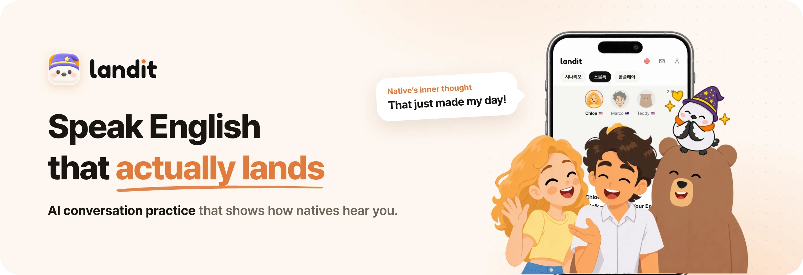
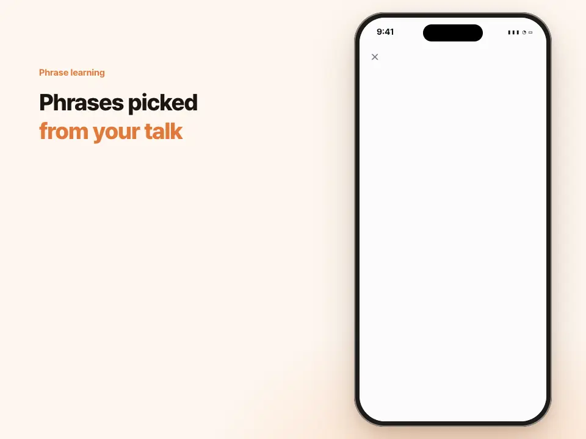

  

<h1 align="center">Landit</h1>

Find out how your English really sounds to native speakers.

<h3 align="center">
  <a href="https://play.google.com/store/apps/details?id=com.saynow.app">📱 Android</a>
  &nbsp;|&nbsp;
  <a href="https://apps.apple.com/app/id6787414201">🍎 iOS</a>
</h3>

<a href="./README.md">한국어</a> · <b>English</b> · <a href="./README.ja.md">日本語</a>

 

## Landit started with this question

-  Your grammar was right — so why did the other person look puzzled?
-  There was no way to tell whether your English sounded rude or natural.
-  Plenty of apps fixed your mistakes. None told you **how you actually sounded**.

So Landit shows you **how you sounded, not just whether you were right**. You talk like in a real conversation, see how the other person reacts, and afterwards build your skills step by step with corrections and phrases matched to your level.

 

## A day with Landit

###  Today’s scenario

Real reactions only happen in real situations. Every day, a moment you’ll face abroad — your first day in the dorm, a class, a café — arrives **at a difficulty matched to your level**.

###  Scenario talk

Say something and instantly see how the other person really took it. Kind words make them smile; rude ones make them 💢 angry. Afterwards, every sentence comes with how it actually sounded.

> **Under the hood**
> - **8 facial expressions** — the emotion the server detects alongside each inner thought (happy, love, angry, sad, sulky, shy, …) drives the character’s face until the next thought arrives.
> - **Lip-sync that follows English pronunciation** — our TTS doesn’t return per-character timings, so we map English spelling to 4 mouth shapes (closed, round, wide, open). Before playback we pre-compute a 10 ms loudness track from the waveform and spread the mouth shapes only over voiced segments, so the mouth never runs ahead during pauses.
> - **Runtime-free character animation** — SVG parts exported from Rive are driven by our own player: blinking, breathing, expression transitions and mouth morphing, all lightweight inside the WebView.

###  Phrase learning

Every awkward moment becomes your next lesson. Landit picks phrases **just one step above your level** from your own conversation, and you make them yours through quizzes, examples and pronunciation.

###  Roleplay

Practice situations no textbook covers. Write any scene — like talking a zombie into going vegetarian — and it becomes a conversation. Use a phrase you learned, and Landit notices.

###  Small talk

English that lands grows through relationships. Three friends **remember** your last chat and ask how you’ve been, so it feels like catching up with friends, not studying.

The app is currently available in Korean and Japanese.

