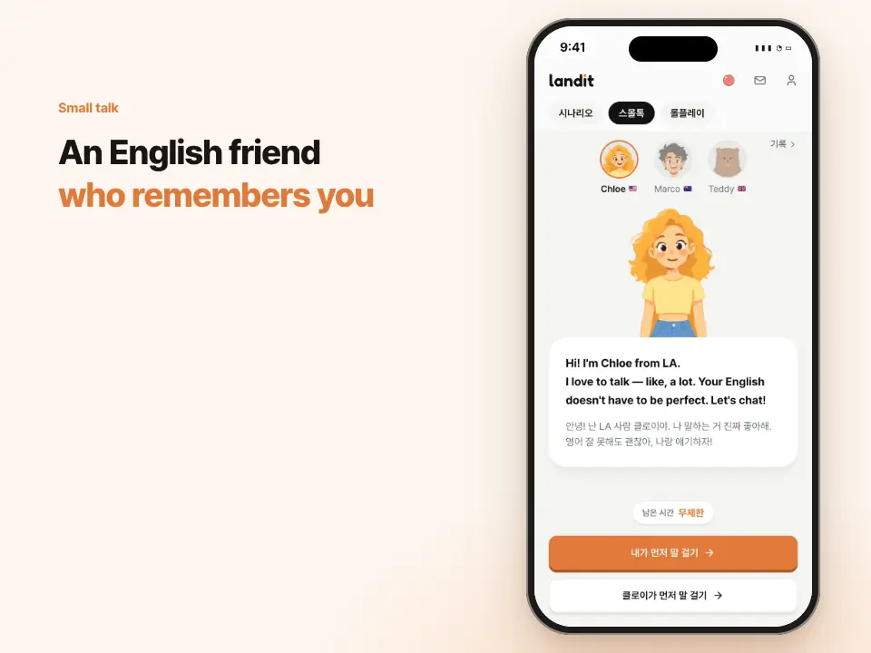

  

<h1 align="center">Landit</h1>

Find out how your English really sounds to native speakers.

<h3 align="center">
  <a href="https://play.google.com/store/apps/details?id=com.saynow.app">📱 Android</a>
  &nbsp;|&nbsp;
  <a href="https://apps.apple.com/app/id6787414201">🍎 iOS</a>
</h3>

<a href="./README.md">한국어</a> · <b>English</b> · <a href="./README.ja.md">日本語</a>

 

## The problem

- Your grammar was right — so why did the other person look puzzled?
- There’s no way to tell whether your English sounded rude or natural.
- Plenty of apps fix your mistakes. None tell you **how you actually sounded**.

 

## How Landit solves it

### 🌅 Today’s scenario

Dorms, classes, cafés — a real situation you’ll face abroad arrives every day.

### 💭 Scenario talk

Talk out loud with an AI character and instantly see their **inner thoughts** and facial reactions. Afterwards, every sentence comes with how it actually sounded.

### 🎭 Roleplay

Write any situation — like talking a zombie into going vegetarian — and it becomes your own illustrated scenario. Phrases you learned get noticed; awkward sentences get fixed.

### 📚 Phrase learning

Phrases picked from your own conversation, learned through quizzes, picture examples and pronunciation coaching.

### ☕ Small talk

Three friends with different accents and personalities **remember** your last chat and ask you first — so practice feels like catching up with a friend.

The app is currently available in Korean and Japanese.

 

Questions or feedback? Open an issue in any repository.

