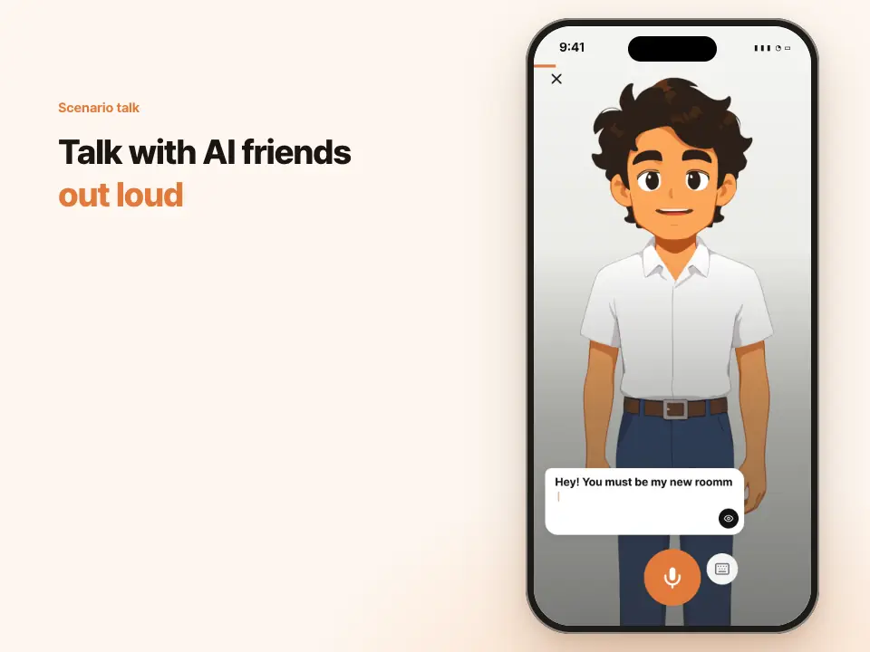

  

  
  
  

<a href="./README.md">한국어</a> · <b>English</b> · <a href="./README.ja.md">日本語</a>

 

Grammatically correct English can still sound rude — and slightly broken English can still land. 
**Landit** is an AI English conversation app that shows you, right in the moment, **how a native speaker actually heard you**.

- 💭 **Native’s inner thoughts** — after every line, see how your partner really took it.
- 🔁 **Conversations that keep flowing** — mistakes don’t stop the talk; corrections come at the end.
- 🪜 **Just one step up** — not hard sentences, but ones you can reuse right away.

 

<table>
  <tr>
    <td width="50%"></td>
    <td width="50%"></td>
  </tr>
  <tr>
    <td width="50%"></td>
    <td width="50%"></td>
  </tr>
</table>

The app is currently available in Korean and Japanese.

 

### Repositories

| | |
| --- | --- |
| [`landit-fe`](https://github.com/Aragornnnnnn/landit-fe) | Web (Next.js) and mobile app (Expo) monorepo |
| [`landit-iac`](https://github.com/Aragornnnnnn/landit-iac) | Infrastructure as code |
| [`landit-admin`](https://github.com/Aragornnnnnn/landit-admin) | Operations admin |
| [`landit-tech-docs`](https://github.com/Aragornnnnnn/landit-tech-docs) | Public design docs and verification notes |

 

Questions or feedback? Open an issue in any repository.

