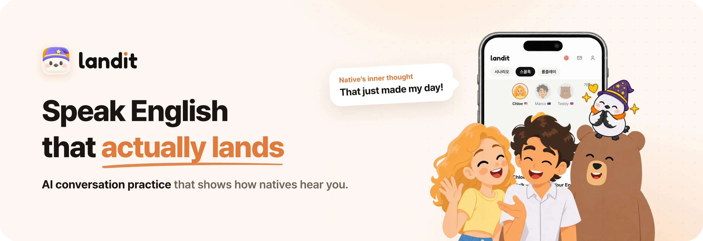
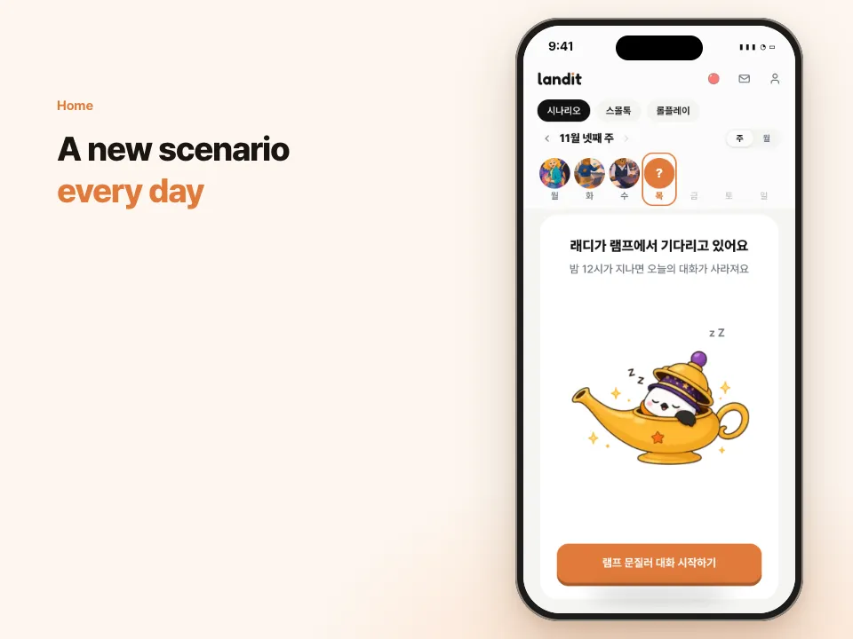

  

<a href="./README.md">한국어</a> · <b>English</b> · <a href="./README.ja.md">日本語</a>

<h1 align="center">Landit</h1>

Find out how your English really sounds to native speakers.

  
  
  
  

 

## Landit started with this question

- Your grammar was right — so why did the other person look puzzled?
- There was no way to tell whether your English sounded rude or natural.
- Plenty of apps fixed your mistakes. None told you **how you actually sounded**.

So Landit focuses on how you sounded, not just whether you were right. You talk like in a real conversation, see how the other person reacts, and afterwards build your skills step by step with corrections and phrases matched to your level.

 

## A day with Landit

###  Today’s scenario

Real reactions only happen in real situations. Every day, a moment you’ll face abroad — your first day in the dorm, a class, a café — arrives at a difficulty matched to your level.

###  Scenario talk

Say something and see how the other person really took it. Characters shift between 8 emotions and move their mouths in sync with English pronunciation. When the talk ends, you get feedback and a detailed analysis for every sentence.

###  Phrase learning

Landit analyzes the conversation you just had, finds phrases you could have said more naturally, and turns them straight into a lesson. Guess them in a quiz first, learn the nuance through pictures and examples, then get your pronunciation corrected.

###  Small talk

Three friends with different accents and personalities remember your last chat and ask how you’ve been — how the hike went, even the names of the friends who came along — so it feels like catching up with friends, not studying.

###  Roleplay

From the job interview you have next week to talking a zombie into going vegetarian, just write the situation and the conversation starts. Use a phrase you learned and Landit notices; awkward sentences get fixed on the spot.

 

The app is currently available in Korean and Japanese.

