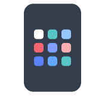
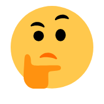
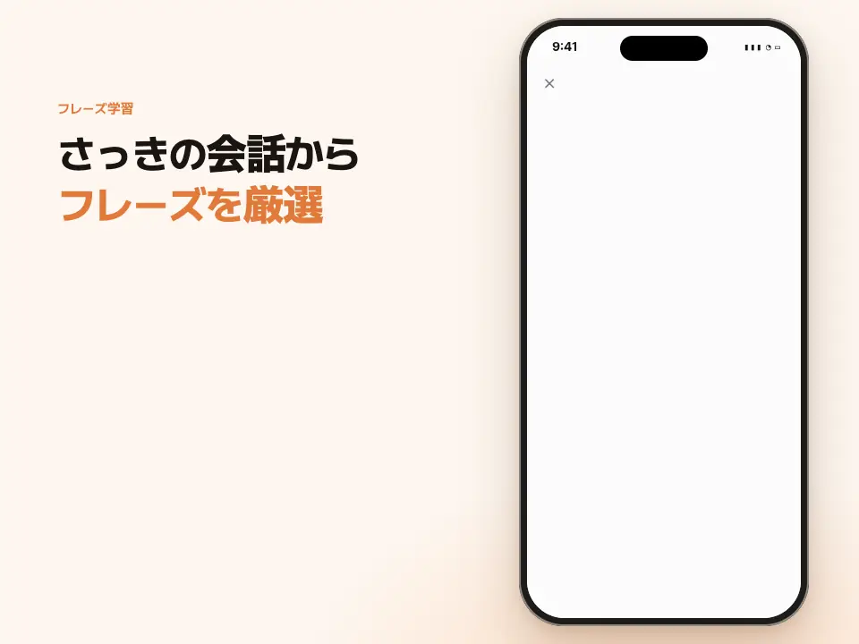

  

<h1 align="center">Landit（ランディット）</h1>

あなたの英語がネイティブにどう聞こえるか、すぐにわかるAI英会話

<h3 align="center">
  <a href="https://play.google.com/store/apps/details?id=com.saynow.app"> Android</a>
  &nbsp;|&nbsp;
  <a href="https://apps.apple.com/app/id6787414201"> iOS</a>
</h3>

<a href="./README.md">한국어</a> · <a href="./README.en.md">English</a> · <b>日本語</b>

 

## Landitはこの問いから始まりました

-  文法は合っているのに、相手の反応がどこかぎこちなかったことはありませんか？
-  自分の英語が失礼に聞こえたのか、自然だったのか、確かめる方法がありませんでした。
-  間違いを直してくれるアプリは多くても、**どう聞こえたか**は誰も教えてくれませんでした。

だからLanditは **「正しかったか」より「どう聞こえたか」** を先に伝えます。本当の会話のように話して相手の反応を確かめ、会話のあとは自分のレベルに合った添削とフレーズで一歩ずつ実力を伸ばします。

 

## Landitで学ぶ一日

###  今日のシナリオ

本当の反応は、本当の場面でこそ生まれます。寮の初日、授業、カフェなど、海外で出会う場面が自分のレベルに合った難易度で毎日ひとつ届きます。

###  シナリオ会話

話しかけると、相手が心の中でどう受け取ったかを見せてくれて、キャラクターは8つの感情で表情を変えながら英語の発音に合わせて口を動かします。会話が終わると、一文ずつフィードバックと詳しい分析が届きます。

###  フレーズ学習

さっきの会話を分析して、もっと自然に言えたところを見つけてくれます。その改善点がそのまま次の学びになり、今のレベルよりちょうど一段上のフレーズをクイズ・例文・発音まで自分のものにします。

###  ロールプレイ

来週の面接のように今すぐ練習したい場面も、ゾンビに菜食をすすめるような想像の場面も、書くだけですぐ会話になります。習ったフレーズを使えば気づいてくれて、不自然な文はその場で添削します。

###  スモールトーク

アクセントも性格も違う3人の友だちが、前回の会話を覚えていて近況を聞いてくれます。山登りはどうだったか、一緒に行った友だちの名前まで覚えているので、勉強ではなく友だちとのおしゃべりのように続きます。

