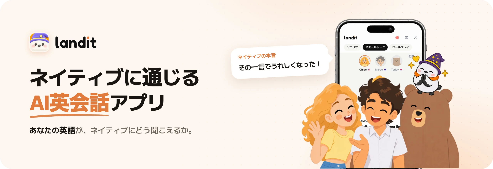
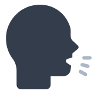
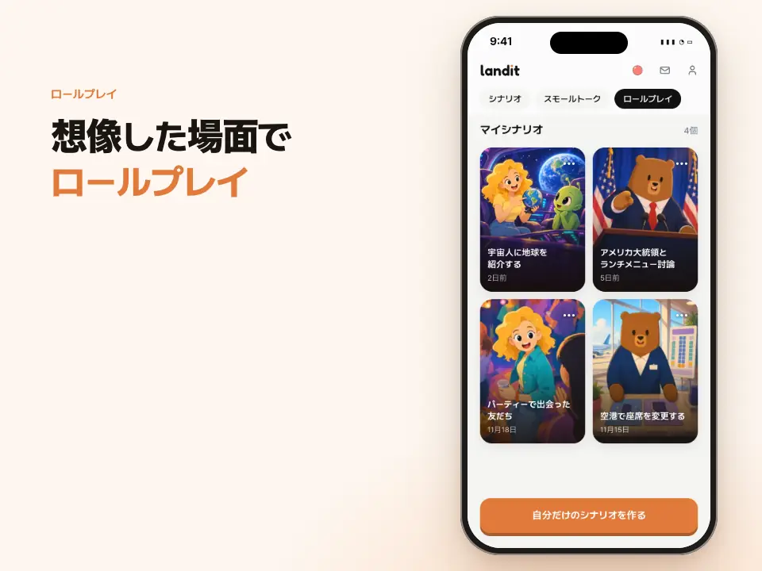
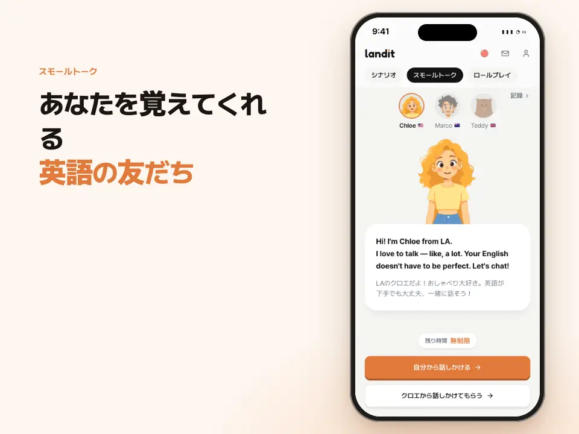

  

<h1 align="center">Landit（ランディット）</h1>

あなたの英語がネイティブにどう聞こえるか、すぐにわかるAI英会話

<h3 align="center">
  <a href="https://play.google.com/store/apps/details?id=com.saynow.app">📱 Android</a>
  &nbsp;|&nbsp;
  <a href="https://apps.apple.com/app/id6787414201">🍎 iOS</a>
</h3>

<a href="./README.md">한국어</a> · <a href="./README.en.md">English</a> · <b>日本語</b>

 

## Landitはこの問いから始まりました

-  文法は合っているのに、相手の反応がどこかぎこちなかったことはありませんか？
-  自分の英語が失礼に聞こえたのか、自然だったのか、確かめる方法がありませんでした。
-  間違いを直してくれるアプリは多くても、**どう聞こえたか**は誰も教えてくれませんでした。

だからLanditは **「正しかったか」より「どう聞こえたか」** を先に伝えます。本当の会話のように話して相手の反応を確かめ、会話のあとは自分のレベルに合った添削とフレーズで一歩ずつ実力を伸ばします。

 

## Landitで学ぶ一日

###  今日のシナリオ

本当の反応は、本当の場面でこそ生まれます。寮の初日、授業、カフェなど、海外で出会う場面が**自分のレベルに合った難易度**で毎日ひとつ届きます。

###  シナリオ会話

話しかけると、相手が心の中でどう受け取ったかがすぐにわかります。うれしい言葉には笑い、失礼な言葉には💢怒ります。会話のあとは一文ずつ「日本語にするとこう聞こえました」と教えてくれます。

> **こうやって作りました**
> - **8つの表情** — 本音と一緒にサーバーが判別した感情（うれしい・好き・怒り・悲しい・すねる・照れるなど）をキャラクターの表情に変え、次の本音が届くまで保ちます。
> - **英語の発音に合わせたリップシンク** — TTSが文字ごとのタイミングを返さないため、英語のつづりを4つの口の形（閉じる・すぼめる・横に開く・大きく開く）に変換します。再生前に音声波形から10ms単位の音量表を作り、音が出ている区間だけに口の形を割り当てるので、間の部分で口が先走りません。
> - **ランタイム不要のキャラクターアニメーション** — Riveから書き出したSVGパーツを自前のプレイヤーで動かし、まばたき・呼吸・表情の切り替え・口のモーフィングをWebView内で軽く動かします。

###  フレーズ学習

ぎこちなかった瞬間が、そのまま次の学びになります。さっきの会話から**今のレベルよりちょうど一段上**のフレーズを選び、クイズ・例文・発音まで自分のものにします。

###  ロールプレイ

教科書にない場面も練習できます。ゾンビに菜食をすすめるような想像した場面を書けばすぐに会話になり、習ったフレーズを使えば気づいてくれます。

###  スモールトーク

通じる英語は、つながりの中で伸びていきます。3人の友だちが前回の会話を**覚えていて**近況を聞いてくれるので、勉強ではなく友だちとのおしゃべりのように続きます。

