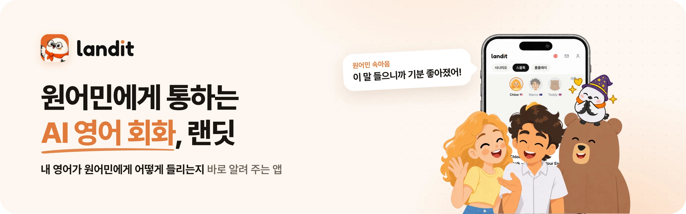

  

<h1 align="center">랜딧 (Landit)</h1>

내 영어가 원어민에게 어떻게 들리는지, 바로 알려 주는 AI 영어 회화

<h3 align="center">
  <a href="https://play.google.com/store/apps/details?id=com.saynow.app">📱 Android</a>
  &nbsp;|&nbsp;
  <a href="https://apps.apple.com/app/id6787414201">🍎 iOS</a>
</h3>

<b>한국어</b> · <a href="./README.en.md">English</a> · <a href="./README.ja.md">日本語</a>

 

## 이런 문제가 있어요

- 문법은 맞았는데, 상대 반응이 어딘가 어색했던 적 있나요?
- 내 영어가 무례하게 들렸는지, 자연스러웠는지 알 길이 없어요.
- 틀린 걸 고쳐 주는 앱은 많지만, **어떻게 들렸는지**는 아무도 알려 주지 않아요.

 

## 이렇게 해결해요

### 🌅 오늘의 시나리오

기숙사, 수업, 카페까지. 해외에서 실제로 마주칠 상황이 매일 하나씩 도착해요.

### 💭 시나리오 대화

AI 캐릭터와 말로 대화하면, 내 말을 들은 상대의 **속마음**과 표정이 바로 보여요. 대화가 끝나면 문장마다 한국어로 치면 어떻게 들렸는지 알려 줘요.

### 🎭 롤플레이

좀비에게 채식 권하기처럼 상상한 상황을 적으면, 그림까지 그려진 나만의 시나리오가 돼요. 배운 표현을 쓰면 알아보고, 어색한 문장은 바로 고쳐 줘요.

### 📚 표현 학습

방금 대화에서 원어민처럼 말할 수 있는 표현을 골라, 퀴즈·그림 예문·발음 교정까지 이어서 익혀요.

### ☕ 스몰톡

억양도 성격도 다른 세 친구가 지난 대화를 **기억하고** 먼저 말을 걸어요. 친구처럼 이어지는 대화 속에서 자연스럽게 늘어요.

