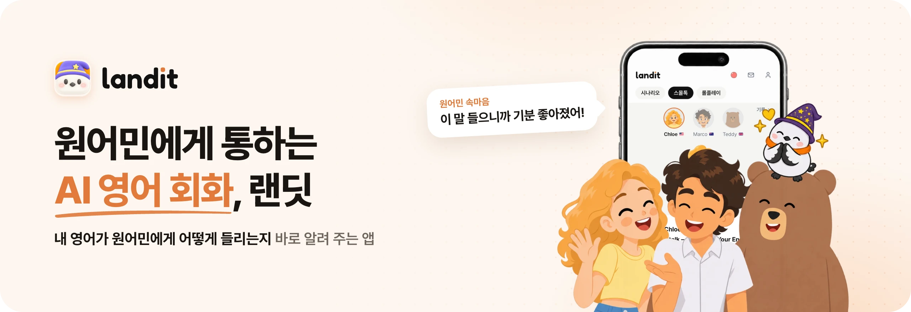
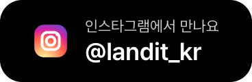

  

<b>한국어</b> · <a href="./README.en.md">English</a> · <a href="./README.ja.md">日本語</a>

<h1 align="center">랜딧 (Landit)</h1>

내 영어가 원어민에게 어떻게 들리는지, 바로 알려 주는 AI 영어 회화

  
  
  
  

 

## 랜딧은 이 질문에서 시작했어요

- 문법은 맞았는데, 상대 반응이 어딘가 어색했던 적 있나요?
- 내 영어가 무례하게 들렸는지, 자연스러웠는지 알 길이 없었어요.
- 틀린 걸 고쳐 주는 앱은 많았지만, **어떻게 들렸는지**는 아무도 알려 주지 않았어요.

그래서 랜딧은 **'맞았는지'보다 '어떻게 들렸는지'** 를 먼저 알려 줘요. 실제 대화처럼 말하며 상대의 반응을 보고, 대화가 끝나면 내 수준에 맞는 교정과 표현으로 한 단계씩 실력을 올려요.

 

## 랜딧으로 배우는 하루

###  오늘의 시나리오

진짜 반응은 진짜 상황에서 나와요. 기숙사 첫날, 수업, 카페처럼 해외에서 마주칠 순간이 내 수준에 맞는 난이도로 매일 하나씩 도착해요.

###  시나리오 대화

말을 건네면 상대가 내 말을 속으로 어떻게 받아들였는지 보여 주고, 캐릭터는 8가지 감정으로 표정을 바꾸며 영어 발음에 맞춰 입을 움직여요. 대화가 끝나면 문장마다 피드백과 상세 분석을 받아요.

###  표현 학습

방금 나눈 대화를 분석해 더 자연스럽게 말할 수 있었던 표현을 찾아 주고, 그 표현으로 바로 학습을 이어가요. 퀴즈로 먼저 맞혀 보고, 그림과 예문으로 뉘앙스를 익힌 뒤, 발음까지 교정받아요.

###  롤플레이

다음 주 면접처럼 당장 연습해야 하는 상황도, 좀비에게 채식 권하기 같은 상상 속 장면도 적기만 하면 바로 대화가 돼요. 대화하면서 배운 표현을 쓰면 알아보고, 어색한 문장은 바로 고쳐 줘요.

###  스몰톡

억양도 성격도 다른 세 친구가 지난 대화를 기억하고 먼저 안부를 물어요. 지난번 말한 등산은 어땠는지, 같이 간 친구 이름까지 기억해서 공부가 아니라 친구와 수다 떠는 것처럼 이어져요.

