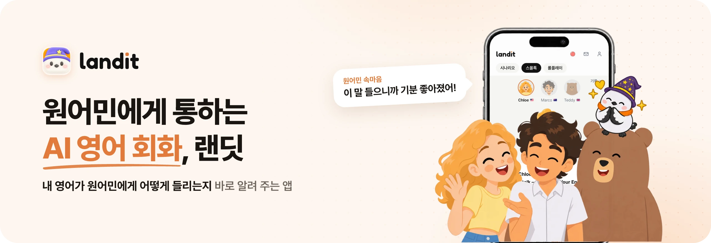
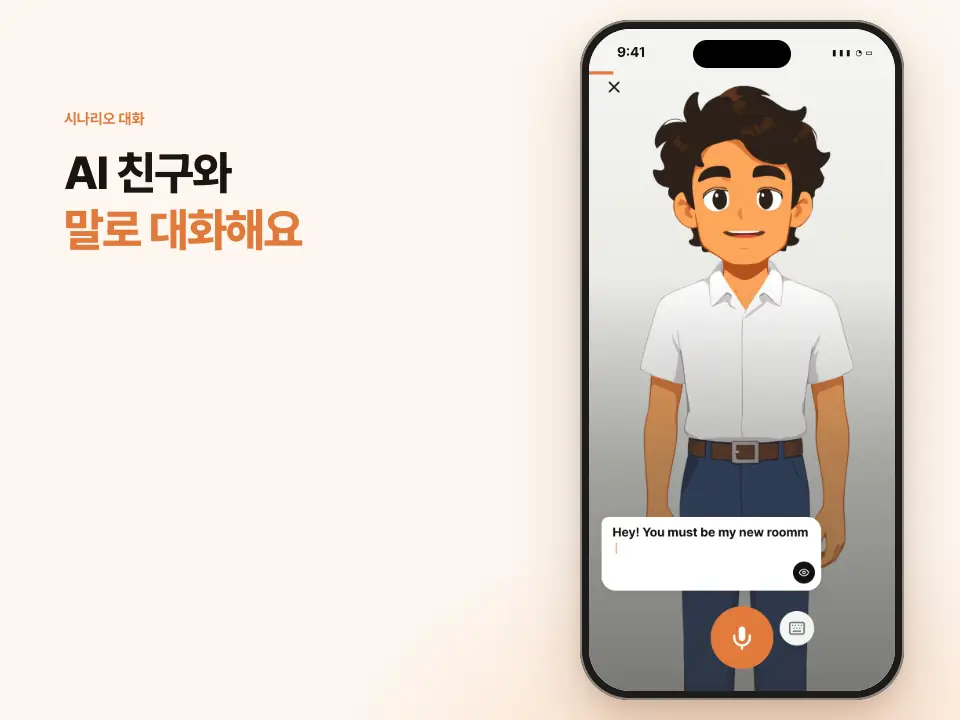

  

<h1 align="center">랜딧 (Landit)</h1>

내 영어가 원어민에게 어떻게 들리는지, 바로 알려 주는 AI 영어 회화

<h3 align="center">
  <a href="https://play.google.com/store/apps/details?id=com.saynow.app">📱 Android</a>
  &nbsp;|&nbsp;
  <a href="https://apps.apple.com/app/id6787414201">🍎 iOS</a>
</h3>

<b>한국어</b> · <a href="./README.en.md">English</a> · <a href="./README.ja.md">日本語</a>

 

## 랜딧은 이 질문에서 시작했어요

- 문법은 맞았는데, 상대 반응이 어딘가 어색했던 적 있나요?
- 내 영어가 무례하게 들렸는지, 자연스러웠는지 알 길이 없었어요.
- 틀린 걸 고쳐 주는 앱은 많았지만, **어떻게 들렸는지**는 아무도 알려 주지 않았어요.

그래서 랜딧은 **'맞았는지'보다 '어떻게 들렸는지'** 를 먼저 알려 줘요. 실제 대화처럼 말하며 상대의 반응을 보고, 대화가 끝나면 내 수준에 맞는 교정과 표현으로 한 단계씩 실력을 올려요.

 

## 랜딧으로 배우는 하루

### 🌅 오늘의 시나리오

진짜 반응은 진짜 상황에서 나와요. 기숙사 첫날, 수업, 카페처럼 해외에서 마주칠 순간이 **내 수준에 맞는 난이도**로 매일 하나씩 도착해요.

### 💭 시나리오 대화

말을 건네면 상대가 속으로 어떻게 받아들였는지가 바로 보여요. 기분 좋은 말엔 웃고, 무례한 말엔 💢 화를 내요. 대화가 끝나면 문장마다 "한국어로 치면 이렇게 들렸어요"를 알려 줘요.

### 📚 표현 학습

어색했던 순간은 그대로 다음 공부가 돼요. 방금 대화에서 **내 수준보다 딱 한 단계 위** 표현을 골라, 퀴즈·예문·발음까지 내 것으로 만들어요.

### 🎭 롤플레이

교과서에 없는 상황도 연습할 수 있어요. 좀비에게 채식 권하기처럼 상상한 장면을 적으면 바로 대화가 되고, 배운 표현을 쓰면 알아봐 줘요.

### ☕ 스몰톡

통하는 영어는 결국 관계 속에서 늘어요. 세 친구가 지난 대화를 **기억하고** 먼저 안부를 물어서, 공부가 아니라 친구와 수다처럼 이어져요.

